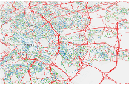
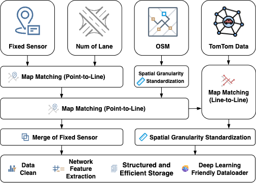

# MMTD: Metropolitan Multi-source Traffic Data

A **large-scale, spatio-temporally aligned multi-source traffic dataset** at metropolitan scale, built for deep learning and traffic state inference. MMTD standardizes heterogeneous fixed sensors and floating car data onto a unified road network, providing a reproducible benchmark for data-driven traffic dynamics modeling.

## Data Access

The **processed fixed-sensor data** (excluding floating car data) is publicly available on Zenodo:

[](https://doi.org/10.5281/zenodo.18781181)

- **Zenodo Record:** [https://doi.org/10.5281/zenodo.18781181](https://doi.org/10.5281/zenodo.18781181)
- **Version:** v1.0
- **Contents:** Processed fixed-sensor data, graph topology, and static road attributes

> **Note on Floating Car Data:** The floating car data used in this project is **TomTom Traffic Stats**, which is a **commercial data product**. Therefore, TomTom data is **not included** in the Zenodo release. Users can obtain TomTom Traffic Stats data directly from [TomTom Developer Portal](https://move.tomtom.com/) under their terms. The TomTom binding code is not included in the public release; please see [TomTom Binding Code](#tomtom-binding-code) below.

## Overview

- **Spatial scope:** Madrid metropolitan area  
- **Temporal resolution:** 15 minutes (aligned across sources)  
- **Road segments:** 25,166 (OSM-based, intersection-to-intersection)  
- **Fixed sensors:** 2,476 (2,371 urban + 105 highway)  
- **Floating car (TomTom):** full network coverage except for living streets. 

MMTD includes **traffic state variables** (flow, speed, travel time, occupancy, congestion index where available), **road static attributes** (length, lanes, speed limit), and **graph topology** (adjacency, betweenness/closeness centrality).

## Data Source Attribution

This dataset is derived from the following original data sources:

| Source | Description | Original Provider |
|--------|-------------|-------------------|
| **Fixed sensors** | ~4,678 loop detectors; 15-min historical data; flow, occupancy, speed (highway), congestion index (urban). | [Ayuntamiento de Madrid](https://datos.madrid.es/dataset/208627-0-transporte-ptomedida-historico) |
| **Lane counts** | Lane-level data for flow normalization. | [Ayuntamiento de Madrid](https://datos.madrid.es/dataset/300723-0-carriles-mapas) |
| **Road network** | Road topology and geometry. | [OpenStreetMap](https://www.openstreetmap.org/) |
| **Floating car** | 15-min aggregates (flow, speed, travel time) on TomTom's segment geometry. | [TomTom](https://developer.tomtom.com/move-portal/guides/traffic-stats/introduction) |

*Madrid fixed-sensor and lane-count data are reusable under the Madrid Open Data terms (Real Decreto Legislativo 1/1996), which requires attribution to the source and author.*

*Analysis period: August 2024.*

<p align="center">
  
  
</p>
<p align="center">
  <em>Left: Fixed sensors (Madrid). Right: TomTom floating car coverage.</em>
</p>

## Pipeline Summary

MMTD was built through the pipeline summarized below. This section documents the methodology; a public release of the complete preprocessing implementation is not planned.

1. **Layer matching**
   - **Point–line:** Match fixed sensors to lane-count layer, then to OSM segments (distance + heading + road-type constraints; search radius 15 m urban / 20 m highway).
   - **Line–line:** Match OSM segments to TomTom network via HMM-based map matching (e.g. [leuvenmapmatching](https://github.com/wmeert/leuvenmapmatching)), with heading consistency and overlap-ratio checks.

2. **Spatial normalization**
   - OSM: merge degree-2 nodes to get intersection-to-intersection segments.
   - TomTom: map and aggregate TomTom segments onto these OSM segments (length-weighted flow; harmonic-mean speed). Highway: further split into ~500 m sub-segments.

3. **Fixed-sensor merge & cleaning**
   - Merge co-located lane-level sensors (sum flow, average speed).
   - Drop sensors with &lt;80% valid ratio; adaptive outlier removal (IQR / 3σ by distribution). No imputation (to preserve evaluation of reconstruction methods).

4. **Graph & packaging**
   - Road segments → graph nodes; connectivity → edges. Features: geography, length, lanes, speed limit, betweenness/closeness centrality.
   - Outputs: adjacency matrix, node features, fixed-sensor and floating-car state tensors (e.g. `T × N × F`), HDF5 + PyG-style dataset and loaders with optional observation masks.



## Dataset Structure (High Level)

- **Graph:** adjacency (sparse), node features (geo + static + centrality).
- **Fixed sensor:** `T × N_s × F_s` (e.g. flow, occupancy, speed/congestion).
- **Floating car:** `T × N_f × F_f` (e.g. flow, speed, travel time); `N_f` covers full network.
- **Alignment:** common segment IDs link all components.

## Repository Contents

- **Processing methodology:** an overview of layer matching, spatial normalization, cleaning, and graph/dataset construction. The complete preprocessing code is not planned for public release; interested readers are welcome to contact the authors.
- **Processed fixed-sensor data:** publicly available on [Zenodo](https://doi.org/10.5281/zenodo.18781181) (CC BY 4.0 license).
- **TomTom binding:** methodology described above; the binding code is not planned for public release (see [TomTom Binding Code](#tomtom-binding-code)).
- **Data loaders:** a [standalone adaptation of the TA-ANP loader](data_provider/README.md), with PyG datasets, spatio-temporal sampling, and observation masks. Supports fixed-sensor data without TomTom, with a [runnable example](examples/load_fixed_sensor.py).

*The public release includes loader code, processing methodology, and processed fixed-sensor outputs. TomTom data and binding notebooks are not included.*

## TomTom Binding Code

The TomTom binding workflow was developed in research notebooks containing exploratory analyses, intermediate drafts, and experiment-specific steps. Given the time elapsed since the original development, reconstructing the complete workflow and its execution details would require further review and organization. We therefore do not plan to publicly release these notebooks as a standalone implementation.

If you are interested in aligning TomTom data with MMTD or learning more about the binding workflow, please contact [Qishen Zhou](mailto:qishenzhou@jlu.edu.cn) directly.

## Getting Started

1. Clone the repository and use Python 3.11 with a suitable PyTorch installation.
2. Install the loader dependencies: `python -m pip install -r requirements.txt`.
3. Download `distance_matrix.h5`, `road_info.h5`, and `fixed_sensor_data.h5` from [Zenodo](https://doi.org/10.5281/zenodo.18781181) into one directory.
4. From the repository root, run `python -m examples.load_fixed_sensor --data-root /path/to/MMTD` to load a PyG batch. See the [loader guide](data_provider/README.md) for input formats, sampling, masks, and optional already aligned TomTom inputs.

If you are interested in constructing the full MMTD (fixed + TomTom), acquire TomTom data for the same period/area under TomTom's terms and [contact the authors](#tomtom-binding-code) to discuss alignment.

## Citation

If you use MMTD in your work, please cite:

### Dataset (Zenodo)

When using the **processed data**, please cite the Zenodo record:

```bibtex
@dataset{zhou2026mmtd,
  author       = {Zhou, Qishen},
  title        = {MMTD: Madrid Fixed-Sensor Traffic Data (Processed
                   Sample for Reproducible Research)},
  month        = feb,
  year         = {2026},
  publisher    = {Zenodo},
  version      = {v1.0},
  doi          = {10.5281/zenodo.18781181},
  url          = {https://doi.org/10.5281/zenodo.18781181}
}
```

### Thesis Reference

```bibtex
@phdthesis{zhouphd,
  author = {Qishen Zhou},
  title  = {Resilient Inference and Uncertainty Quantification for Global Traffic State Using Sparse Data},
  school = {Zhejiang University},
  year   = {2026}
}
```

## License

- **Code:** [MIT License](LICENSE), except the attributed time-feature utility, which retains its [Apache-2.0 license](licenses/Apache-2.0.txt).
- **Processed data** we distribute in this repository: **CC BY 4.0** — attribution appreciated; otherwise use freely. ([Summary](https://creativecommons.org/licenses/by/4.0/))
- **Underlying data sources** (Madrid, TomTom, OSM) are subject to their own terms. We do not grant rights beyond what those sources allow.
